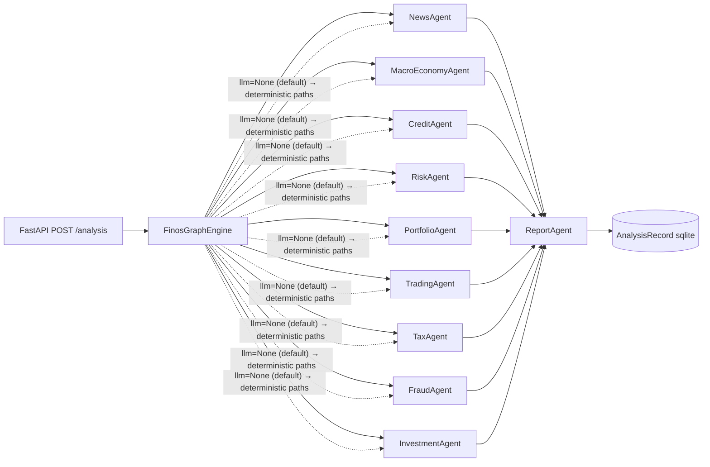

# FinOS — Read-Only Audit Report

- **Date:** 2026-10-14
- **Repo:** `D:\Projects\FinOS\FINOS`
- **HEAD:** `94000ac` — "chore: remove generated frontend files" (`integrate/fd-frontend-auth`, `origin/main`, `origin/HEAD`)
- **Nature:** Read-only audit. No source was modified, restored, deleted, or reorganized.
- **Evidence rule:** every claim below cites repo-relative paths/symbols; fact vs assumption is separated.

---

## A. Executive Summary

1. The FinOS domain layer is `finos/core/` (50 files, tracked in HEAD `94000ac`) but it is **deleted in the working tree** (unstaged ` D finos/...`, ~3502 deletions). Therefore `import finos` fails, the backend `/analysis` endpoint cannot start, and 16+ test modules fail collection.
2. `finos/agents/` as a separate top-level package **never existed** in any commit or object. The real agents are `finos/core/agents/*`. The feared duplication is not real.
3. The advertised "10-agent connected workflow" is, under the default configuration, almost entirely **deterministic heuristics/arithmetic**, not LLM reasoning. LLM-backed branches only activate when an LLM is explicitly constructed (provider `google` + `GOOGLE_API_KEY`).
4. Two untracked tests (`tests/test_narrative_quality.py`, `tests/test_tigerdata.py`) reference APIs that were **never committed and exist nowhere** in git history, the object store, `build/lib`, or the working tree. They are orphaned, spec-first test artifacts written on **2026-09-26**, for a feature whose implementation was never committed and is not recoverable from git.
5. Docs contradict each other and the disk: `FINOS_AGENT_ARCHITECTURE.md` (root) claims agents `IMPLEMENTED`; `docs/FINOS_ARCHITECTURE_AUDIT.md` (2026-09-25) says `finos/core/` is a foundation/stub layer.
6. The working tree is in a broken, half-migrated state (missing `finos/`, orphaned tests, modified `pyproject.toml`/`.env.example`). This should be resolved before any feature work.

---

## B. Repository Map (verified on disk)

```
backend/        FastAPI service (app/, tests/)  — auth, analysis, reports, entity resolver
cli/            CLI entry
config/         config files
frontend/       Next.js UI (components/market/NewsFeed.tsx, lib/api/analysis.ts)
tradingagents/  runtime engine (agents/, dataflows/, llm_clients/, reporting/)
tests/          suite (~1000 passing) + FinOS/backend integration tests
docs/           architecture + audit + sample report + this report
main.py         TradingAgentsGraph(...).propagate("NVDA", ...)   — tradingagents CLI entry
pyproject.toml  name=tradingagents v0.5.1; packages include finos*; testpaths tests + backend/tests
uv.lock         lockfile
docker-compose.yml / Dockerfile   build & ENTRYPOINT `tradingagents` (CLI only; no backend/frontend service)
.env.example / .env / backend/.env   (TIGERDATA_* still documented in .env.example and .env)
finos/          *** MISSING ON DISK, tracked in HEAD ***
```

- No `finos/agents/` anywhere.
- No Kafka / Neo4j / Qdrant present (the target feature must not add these prematurely).

---

## C. Verified Runtime Architecture

### C.1 Backend execution path (current)

```
client
  → FastAPI                      backend/app/main.py
  → POST /analysis               backend/app/api/analysis.py
        ↳ line 26: from finos.core.graph.engine import FinosGraphEngine   ← TypeError/ImportError here
  → _get_engine()                builds an LLM ONLY when provider == "google" AND GOOGLE_API_KEY set,
                                 otherwise llm = None
  → FinosGraphEngine.execute()   runs the 10 agents
  → ReportAgent / write_report_tree
  → persisted AnalysisRecord (sqlite:///./finos.db)
```

### C.2 Verified current graph



### C.3 Supporting modules

- `backend/app/core/config.py` — `Settings`: `DATABASE_URL` (`sqlite:///./finos.db`), JWT, OTP, OAuth, SMTP.
- `backend/app/services/entity_resolver.py` — `resolve_entity`, `KNOWN_COMPANY_ALIASES` (yf.Search + Dhan master).
- `backend/app/api/reports.py` — report retrieval routes.

### C.4 Config disconnect (fact)

FinOS agents call `tradingagents.dataflows.router.route_to_vendor(...)`, which reads `tradingagents.dataflows.config.get_config()` (i.e. `DEFAULT_CONFIG`), **not** `FINOS_CONFIG`. Consequently `FINOS_CONFIG`'s vendor-related keys are inert for data fetching.

---

## D. Agent Inventory (`finos/core/agents/`)

| Agent | File | LLM? | Backing data / logic |
|---|---|---|---|
| News | `news.py` | **No** | keyword heuristics; `NewsAssessment` |
| Macro | `macro.py` | **No** | FRED `get_macro_data` |
| Credit | `credit.py` | No | deterministic arithmetic |
| Risk | `risk.py` | Conditional | 3 debators when `llm` passed; else keyword heuristics |
| Portfolio | `portfolio.py` | Conditional | `create_portfolio_manager` when `llm` |
| Trading | `trading.py` | Conditional | `create_trader` when `llm` |
| Investment | `investment.py` | Conditional | bull/bear/research_manager when `llm`; else "Hold" |
| Tax | `tax.py` | No | deterministic arithmetic |
| Fraud | `fraud.py` | No | deterministic arithmetic |
| Report | `report.py` | No | `tradingagents.reporting.write_report_tree` |

**Supporting core:**
- `finos/core/graph/engine.py` — `FinosGraphEngine` (instantiates the 10 agents; `execute`).
- `finos/core/graph/propagation.py` — `StatePropagator.create_initial_state` (`FinosState` keys).
- `finos/core/state/base.py`, `finos/core/state/bridge.py` — `FinosState`, `finos_state_from_agent_state`.
- `finos/core/schemas/sentiment.py` — `SentimentBand`, `SentimentScore` (0–10 scale) — reusable.
- `finos/core/config.py` — `FINOS_CONFIG`, `FINOS_*` env handling (see C.4 caveat).
- `finos/core/llm/factory.py` — LLM factory wrapper.
- `finos/core/memory/decision_log.py` — **stub**: `record_assessment` is a no-op ("Entry appending logic will be connected in Phase B3"); `get_past_context` returns `""`.

**Prior art inside the runtime (most relevant to the target feature):**
- `tradingagents/agents/analysts/sentiment_analyst.py` — existing sentiment stack (Yahoo news + StockTwits + Reddit; optional TypeSafe Jev screen).
- `tradingagents/agents/schemas.py` — `SentimentBand` (~L296), `SentimentReport` (~L311), `render_sentiment_report` (~L366).
- `tradingagents/agents/context.py:211` — `get_user_query_from_state` (emits `User Inquiry / Request: "..."`).

---

## E. Data Pipeline Audit

- **Central dispatch:** `tradingagents/dataflows/router.py` — `route_to_vendor`.
- **Vendors:** `yahoo/{news,ohlcv,market,fundamentals,snapshot}`, `alpha_vantage/*`, `fred.py`, `polymarket.py`, `reddit.py`, `stocktwits.py`, `sec_edgar.py`.
- **News shape defect (fact):** `tradingagents/dataflows/vendors/yahoo/news.py` (`_extract_article_data`) returns a formatted **markdown string**, not a list of dicts. `NewsAgent`'s `isinstance(articles, list)` branch therefore never fires on real runs → `normalized_articles` stays empty → weak `evidence` / `key_events`.
- **Point-in-time (PIT):**
  - Tools inject `trade_date` and clamp via `as_of` / `as_of_window` (`tradingagents/agents/tools.py`).
  - FRED pins the data vintage (`realtime_start`/`realtime_end`) and clamps to US-Central "today" (`tradingagents/dataflows/vendors/fred.py:192`) — solid PIT for macro.
  - Yahoo news PIT is weaker — no per-article timestamp enforcement was found.
- **Caching:** `TRADINGAGENTS_CACHE_DIR` (default `~/.tradingagents`).
- **Macro tool:** `tradingagents/dataflows/vendors/fred.py:get_macro_data` returns a markdown report (title, units, frequency, latest, window change, table). Requires `FRED_API_KEY` or raises `FredNotConfiguredError` (degrades gracefully).

---

## F. Sentiment & Market-Impact Capability (target dimensions A–E)

| Dim | Meaning | Status today |
|---|---|---|
| A | Sentiment classification | Partial. `tradingagents/agents/analysts/sentiment_analyst.py` + optional Jev screen exist; FinOS `NewsAgent` does keyword scoring only |
| B | Event / factor extraction | Weak. Markdown news is never parsed into structured events (`key_events` empty) |
| C | Factor-relationship (transmission) reasoning | **Missing** in FinOS |
| D | Empirical market validation | **Missing** (no event-study / backtest linkage in any agent) |
| E | Causal inference | **Missing** (D without causal design) |

---

## G. Gap Analysis

1. **Runtime blocked** — `finos/` missing; backend + 16 test modules fail collection.
2. **Orphaned feature specs** — narrative fields (`what_this_means`, `why_it_matters`, `key_findings`, `watch_items`, `data_status`) and `finos.tigerdata.*` are referenced only by untracked tests; no implementation exists anywhere. `.env.example`/`.env` still document `TIGERDATA_*`.
3. **Sentiment events not structured** — markdown-in prevents B/C/D/E.
4. **Factor transmission + market validation absent** — no C/D/E at all.
5. **Config disconnect** — FinOS vendor config ignored by the router (C.4).
6. **Memory log is a stub** — no lesson capture/retrieval despite the docstring's promise.
7. **Docs vs reality divergence** — three sources disagree (`FINOS_AGENT_ARCHITECTURE.md`, `docs/FINOS_ARCHITECTURE_AUDIT.md`, and the disk).

---

## H. Origin Investigation — orphaned narrative/tigerdata work

**Question:** where did the `tigerdata` + narrative-quality feature come from?

**Method & evidence:**

| Probe | Result |
|---|---|
| `git log --all -S "tigerdata"` / `-S "what_this_means"` (pickaxe) | **empty** — no commit ever added/removed these strings |
| `git rev-list --all` × `git ls-tree` grepped for `tigerdata` | **empty** — no tree/blob in any commit |
| `git log --all -- finos/tigerdata/**` | **empty** |
| `git fsck --lost-found --no-reflogs` | **no dangling objects** |
| `git stash list` | **empty** |
| `build/lib` search | only `finos/core/schemas/sentiment.py`, `tradingagents/agents/analysts/sentiment_analyst.py` (stale build; no tigerdata) |
| Repo-wide grep (`*.py`, excluding `.venv`/`node_modules`/`.git`) | matches ONLY `tests/test_tigerdata.py`, `tests/test_narrative_quality.py` |
| `$env:TEMP` grep | none |
| Branch tips for `finos/` | `origin/main`, `backup-main`, `main` = 50 files; `origin/ayushsingh`, `origin/fd` = 0 files |

**Timeline (from reflog + commit dates + file mtimes):**

- 2026-09-25 — `Initial FinOS baseline` → `agent working till 6pm` → `feat: complete FinOS 10-agent connected workflow` (`main`/`backup-main`) → frontend work (`origin/fd`, `origin/ayushsingh`: "ask feature", "build FinOS frontend") → `feat: connect Ask FinOS to real agent engine`.
- 2026-09-26 — `sab working on 8 am` → `chore: clean generated frontend files` → `chore: remove generated frontend files` (`94000ac`, current HEAD) → also that day: `tests/test_tigerdata.py` (10:36), `tests/test_narrative_quality.py` (12:11), `pyproject.toml` modified (12:31), `.env.example` modified (10:36).

**Conclusion (fact):** The narrative-quality and `finos.tigerdata` work was **never committed to any ref, tree, or object**. It exists solely as untracked test files from the 2026-09-26 session, written TDD-style against a design that was never implemented. It is **not recoverable from git**; only the test specs survive. Recovering it requires reimplementation against those specs (or a decision to discard them). Combined with the working-tree deletion of `finos/`, the 2026-09-26 session left the repo in an uncommitted, broken state.

---

## I. Proposed Integration Design — Sentiment Analysis & Market Impact Agent

**Principle:** build on existing pieces; keep dimensions A–E explicitly separated; do not conflate classification, extraction, transmission, validation, and causal inference.

```mermaid
flowchart TB
  NEWS[News + Social raw] --> PARSE[NewsParser → structured NewsItem{ts,source,title,body}]
  PARSE --> A[A. Sentiment classify → SentimentScore]
  PARSE --> B[B. Event extract → Event{type,entities,severity,timestamps}]
  A --> C
  B --> C[C. Factor transmission → FactorImpact{factor,direction,horizon,confidence}]
  C --> D[D. Empirical validation: event-study CAR / abnormal returns, PIT-safe]
  D --> E[E. Causal design: controls, placebo, pre-trends — only when D supports it]
  E --> OUT[SentimentMarketImpactReport\nwhat_this_means / why_it_matters / key_findings / watch_items / data_status]
  OUT --> REP[ReportAgent]
```

**Design rules:**
- Reuse `tradingagents/agents/schemas.py` and `finos/core/schemas/sentiment.py`.
- Consume data via `route_to_vendor`.
- D/E are optional; when data or keys are missing, emit explicit `UNAVAILABLE` / `data_status` markers (consistent with the orphaned tests' intent).
- Either wire `FINOS_CONFIG` into the router or document the override.
- Add no new infrastructure.

---

## J. Proposed File-Level Change Plan (NOT executed)

- `finos/core/agents/sentiment_market_impact.py` — new agent wrapping A–E.
- `finos/core/schemas/sentiment_impact.py` — report schema with narrative fields.
- `finos/core/data/news_parser.py` — structured parse of markdown news (fixes E.2 defect).
- `finos/core/graph/engine.py` — register the new agent (data/LLM-gated).
- `tests/test_finos_sentiment_impact_agent.py` — new tests.
- **Decision-gated:** (a) restore `finos/`; (b) revive or discard the narrative/tigerdata specs; (c) restore narrative schema fields.

---

## K. Test Baseline & Repo Health

Command:
```
.venv\Scripts\python.exe -m pytest -q --no-header -p no:cacheprovider --continue-on-collection-errors
```
Result: **1001 passed, 5 skipped, 91 subtests passed, 18 errors, 22 warnings in 26.14s**.

- All 18 errors are missing-`finos` import failures (plus secondary issues):
  - `tests/reality/run_reality_test.py`, `tests/test_e2e_integration.py`, `tests/test_entity_resolution.py`, `tests/test_finos_agent_adapters.py`, `tests/test_finos_agent_contracts.py`, `tests/test_finos_credit_agent.py`, `tests/test_finos_fraud_agent.py`, `tests/test_finos_investment_agent.py`, `tests/test_finos_macro_agent.py`, `tests/test_finos_news_agent.py`, `tests/test_finos_state_bridge.py`, `tests/test_finos_tax_agent.py`, `tests/test_narrative_quality.py`, `tests/test_query_sensitivity_fix.py`, `tests/test_reports.py`, `tests/test_tigerdata.py`, `backend/tests/test_analysis.py`, `backend/tests/test_auth.py`.
- `backend/tests/test_analysis.py` additionally errors with `No module named 'tests.test_analysis'` — a **package-name clash** between `tests/` and `backend/tests/` (both importable as `tests`).
- `tests/conftest.py` blanks all `TRADINGAGENTS_*` before import and blocks network via `socket.socket.connect` (marker `integration` bypasses) — good hygiene.
- `main.py` entry only exercises `tradingagents` (NVDA); `docker-compose.yml`/`Dockerfile` build & run only the `tradingagents` CLI — no backend/frontend container.
- Tests importing `finos`: 13 test files + `tests/reality/harness.py`.

---

## L. Risks & Decisions

**Risks**
- **R1** Working-tree deletion of `finos/` leaves the repo non-runnable. *(Decision taken: leave deleted, audit only.)*
- **R2** Orphaned `tigerdata` + narrative-quality specs. *(Decision taken: investigate origin first — done; not recoverable from git.)*
- **R3** Docs contradict each other and the disk; no single source of truth.
- **R4** Dimensions D/E (market validation / causal) need a price/time-series store. The apparent plan was TigerData/TimescaleDB, which is uncommitted. Do not add infrastructure without a decision.
- **R5** Secrets: no secret values were read or exposed; only variable names were observed (`.env` keys: `GOOGLE_API_KEY`, `FRED_API_KEY`, `TRADINGAGENTS_LLM_PROVIDER/DEEP_THINK_LLM/QUICK_THINK_LLM`, `ALPHA_VANTAGE_API_KEY`, `TIGERDATA_DATABASE_URL`, `TIGERDATA_REQUIRE_TIMESCALEDB`; `backend/.env`: `SECRET_KEY`, `ACCESS_TOKEN_EXPIRE_MINUTES`, `FRONTEND_URL`, SMTP_*, `GOOGLE_CLIENT_*`).

**Decisions required from the owner**
1. Should `finos/` be restored from HEAD, or is the deletion intentional?
2. Are the narrative-quality and `tigerdata` specs (K) to be reimplemented, or discarded? (No recoverable source exists.)
3. Which doc is authoritative: `FINOS_AGENT_ARCHITECTURE.md` or `docs/FINOS_ARCHITECTURE_AUDIT.md`?
4. Approve (or not) the target feature design in Sections I–J.

---

## M. Evidence Index

- `backend/app/api/analysis.py:26`; `backend/app/main.py`; `backend/app/core/config.py`; `backend/app/services/entity_resolver.py`
- `tradingagents/dataflows/router.py`; `tradingagents/dataflows/vendors/fred.py:156,192`; `tradingagents/dataflows/vendors/yahoo/news.py`; `tradingagents/agents/tools.py:168`; `tradingagents/agents/analysts/sentiment_analyst.py`; `tradingagents/agents/schemas.py:296`; `tradingagents/agents/context.py:211`
- `finos/core/agents/{news,macro,credit,risk,portfolio,trading,investment,tax,fraud,report}.py`; `finos/core/graph/engine.py`; `finos/core/graph/propagation.py`; `finos/core/schemas/sentiment.py`; `finos/core/config.py`; `finos/core/memory/decision_log.py:30`
- `tests/test_narrative_quality.py`; `tests/test_tigerdata.py`; `tests/test_query_sensitivity_fix.py`; `tests/conftest.py`; `backend/tests/test_analysis.py`
- `FINOS_AGENT_ARCHITECTURE.md`; `docs/FINOS_ARCHITECTURE_AUDIT.md`; `.env.example:71`; `pyproject.toml`; `Dockerfile`; `docker-compose.yml`
- Git evidence: `HEAD=94000ac`; reflog sequence in Section H; empty pickaxe/rev-list/fsck results.
